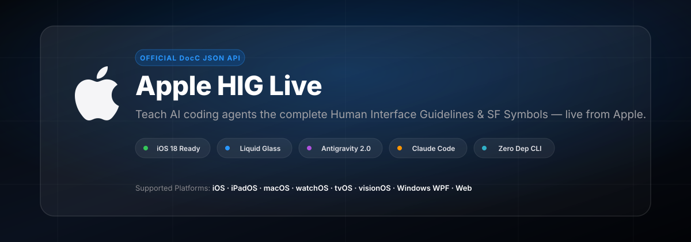

<p align="center">
  
</p>

#  Apple HIG Live: Apple Human Interface Guidelines Skill for AI Coding Agents

**Teach your AI coding agent the entire Apple Human Interface Guidelines (HIG), live.** Design authentic, native iOS, iPadOS, macOS, watchOS, tvOS and visionOS interfaces with SF Symbols, system colors, SF Pro typography and Liquid Glass — straight from Apple's current docs, with every decision cited to its exact HIG page and anchor.

[](https://github.com/emrewyt/apple-hig-live/stargazers)
[](LICENSE)
[](https://github.com/emrewyt/apple-hig-live/actions)


>  **Star this repository** if you care about native, high-grade Apple design and want your AI agents to stop hallucinating UI rules!

---

##  The Problem: Why AI Agents Fail on Apple HIG

When you prompt an AI agent (Claude Code, ChatGPT, Codex, Antigravity) to *"design this screen following Apple's HIG"*, it usually produces generic, outdated, or hallucinated designs. Why?

**Apple's official design website (`developer.apple.com/design`) is rendered purely with client-side JavaScript.** 
When an AI agent opens the URL, it receives an empty HTML shell. (We tested 7 pages across Apple's design docs — all 7 returned completely blank!) As a result, agents hallucinate non-existent modifiers, invent fake SF Symbol names, or apply web patterns to native iOS/macOS apps.

###  The Solution: Real-Time DocC JSON Endpoints

Apple serves the exact same rich content through its official DocC JSON tutorial API:
- **Index:** `https://developer.apple.com/tutorials/data/design/human-interface-guidelines.json`
- **Page (e.g. layout):** `https://developer.apple.com/tutorials/data/design/human-interface-guidelines/layout.json`

**Apple HIG Live** bridges this gap. It provides:
1. **A standard `SKILL.md` specification** for Claude Code, Antigravity 2.0, Codex, and Gemini CLI.
2. **A zero-dependency CLI parser (`hig.py`)** that fetches Apple's live JSON, strips image bloat (reducing payload by 90%), and formats crisp Markdown with section anchors.
3. **Automated Citation & Verification (`hig.py verify`)** ensuring zero hallucinations.
4. **Offline Resilience:** 24h page caching and 7d index caching with automatic fallback.

```text
┌────────────────────────┐      ┌───────────────────────────┐      ┌─────────────────────────────┐
│  Developer / AI Agent  │ ───► │  Apple HIG Live (hig.py)  │ ───► │  Apple DocC JSON Endpoints  │
│  "Design settings UI"  │      │  Zero-Dep Python Runtime  │      │  developer.apple.com/...    │
└────────────────────────┘      └───────────────────────────┘      └─────────────────────────────┘
                                              │                                   │
                                              ▼                                   ▼
                                ┌───────────────────────────┐      ┌─────────────────────────────┐
                                │ Token-Optimized Markdown  │ ◄─── │  Raw JSON Content Stripped  │
                                │ Slug & Anchor Validation  │      │  Images & Bloat Excluded    │
                                └───────────────────────────┘      └─────────────────────────────┘
```

| Feature | Static HIG Copies / Cheat Sheets | **Apple HIG Live** |
|---|---|---|
| **Always Up-to-Date** (Liquid Glass, iOS 27+, visionOS) |  Frozen at copy time |  **Live runtime fetch, cached 24h** |
| **Apple Copyright Infringement** |  Redistributes Apple's text |  **None (fetched dynamically on-demand)** |
| **Repo Size & Maintenance** |  Hundreds of markdown files to sync |  **Single script, 0 external deps** |
| **Full HIG Coverage** |  Curated subsets only |  **Entire HIG via dynamic index crawler** |
| **Verifiable Citations** |  Rare / fabricated |  **Every single decision cites `slug#Anchor`** |
| **Platform Filtering** (iOS, macOS, visionOS) |  No |  **`--platform ios,macos` token trimmer** |
| **Liquid Glass Optical Physics** (Refraction & Dispersion) |  Flat CSS `backdrop-filter: blur()` |  **Snell's Law ($n=1.520$), Abbe ($V_d=58.6$), Fresnel Rims & SVG Dispersion** |
| **Authentic Apple Controls** (Segmented, Switch, Push) |  Generic web toggles & neon glows |  **Native Segmented Pill, 38×22px Switch, Push/Prominent Buttons** |
| **Designer-Grade Vector & Animated SVGs** |  Basic flat 1px wireframe shapes |  **$G^2$ Squircle Grid ($n=4.2$), Multi-Layer SF Symbols & CASpring Curves** |

---

##  Deep Apple Engineering Pillars (v2.0 Upgrade)

Beyond live DocC JSON fetching, **Apple HIG Live** equips AI coding agents with three deep optical, component, and vector engineering references:

1. **Genuine Liquid Glass Optical Physics ([`liquid-glass-physics.md`](skills/apple-hig-live/references/liquid-glass-physics.md))**
   - Replaces naive single-layer CSS blur with physical crown glass optics: **Snell's Law refraction** ($n_d = 1.520$, critical angle $\theta_c = 41.14^\circ$), **Abbe chromatic dispersion** ($V_d = 58.6$), **Schlick Fresnel specular rim lighting** ($R_0 = 4.26\%$), and **SVG `<feTurbulence>` + `<feDisplacementMap>`** (`#hig-liquid-glass-dispersion`).
   - Enforces Apple's strict distinction between `.liquid-glass-regular` (navigation chrome, sidebars, toolbars) and `.liquid-glass-clear-hud` (transient floating media HUDs over a mandatory 35% dimming scrim).
2. **Authentic Apple Components & Anti-Pattern Governance ([`components-and-controls.md`](skills/apple-hig-live/references/components-and-controls.md))**
   - Pixel-accurate blueprints for native **Segmented Controls** (`.apple-segmented-control` with a spring-animated sliding pill `.apple-segment-indicator`), **Standard Switches** (`.apple-switch`, 38×22px track with 18×18px physical thumb), **Continuous Sliders** (`.apple-slider`, 4px track / 20px thumb), and **Push / Prominent Buttons** (`.apple-button-push`, `.apple-button-prominent`).
   - Explicitly bans non-Apple hallucinated patterns (custom `.liquid-toggle` bars, glass-pill sliders, neon `box-shadow` glows, and nested glass-on-glass hierarchies).
3. **Illustrator / Figma / Framer-Caliber Designer SVGs ([`designer-svg-standards.md`](skills/apple-hig-live/references/designer-svg-standards.md))**
   - **macOS App Icon Squircle Geometry:** Exact Lamé superellipse ($|x/a|^{4.2} + |y/b|^{4.2} = 1$) $G^2$ curvature-continuous 12-anchor cubic Bézier path on a `1024×1024` canvas (`824×824` safe body) with a 4-tier optical drop-shadow stack.
   - **Multi-Layer Hierarchical SF Symbols & CASpring Animation:** Variable stroke weights across 9 typographical weights, dual-layer `<g class="symbol-accent symbol-secondary">` + `<g class="symbol-primary">` architecture, and CoreAnimation `CASpringAnimation` physics (`mass: 1.0, stiffness: 300, damping: 24`).

---

##  Quick Install

### Method 1: `npx skills`
```bash
npx skills add emrewyt/apple-hig-live
```

### Method 2: One-Line Automated Installer

Clone the repo and run the installer for your target agents:

```bash
git clone https://github.com/emrewyt/apple-hig-live.git
cd apple-hig-live

# macOS / Linux (All agents: Claude Code, Antigravity, Codex, Gemini, Cursor)
./install.sh all

# Or install for a specific agent in project scope:
./install.sh antigravity project
./install.sh claude project
```

```powershell
# Windows (PowerShell)
powershell -ExecutionPolicy Bypass -File .\install.ps1

# Or target Antigravity 2.0 or Claude specifically:
powershell -ExecutionPolicy Bypass -File .\install.ps1 -Target antigravity -Scope user
powershell -ExecutionPolicy Bypass -File .\install.ps1 -Target claude -Scope project
```

#### Skill Destination Paths

| Agent | Global / User Scope | Project / Workspace Scope |
|---|---|---|
| **Google Antigravity 2.0** | `~/.gemini/config/skills/` | `.agents/skills/` |
| **Claude Code** | `~/.claude/skills/` | `.claude/skills/` |
| **OpenAI Codex** | `~/.codex/skills/` | `.codex/skills/` |
| **Gemini CLI** | `~/.gemini/skills/` | `.gemini/skills/` |
| **Cursor / Windsurf** | `~/.cursor/skills/` | `.cursor/skills/` |

---

##  Ready-to-Use Prompts (Zero Install Option)

Don't want to install anything? You can copy-paste the official prompt directly into **ChatGPT (GPT-4o)**, **Claude Code**, **Cursor**, or **Windsurf**:

###  Türkçe Prompt
```text
Uygulamamın ekranlarını Apple'ın Human Interface Guidelines (HIG) kurallarına göre tasarla.

Sayfaları web sitesinden değil, doğrudan Apple'ın JSON adreslerinden oku:
1. Önce https://developer.apple.com/tutorials/data/design/human-interface-guidelines.json ile içindekileri al.
2. İşine yarayan her sayfayı https://developer.apple.com/tutorials/data/design/human-interface-guidelines/SAYFA.json biçiminde aç (en az layout, typography, color, tab-bars, lists-and-tables, sf-symbols ve materials).
3. İkonlarda SF Symbols, renklerde sistem renkleri (system colors), tipografide sistem fontu (Dynamic Type) kullan.
4. Her tasarım kararının yanına hangi HIG sayfasından ve anchor'dan aldığını yaz (Örnek: `// HIG: layout#Size-classes` veya karar tablosu).
5. Hafızandan veya tahminle kural uydurma; aldığın tüm değer ve prensipleri JSON'dan doğrulayarak aktar.
```

###  English Prompt
```text
Design my app's screens according to Apple's Human Interface Guidelines (HIG).

Read the guidelines directly from Apple's official JSON endpoints, not the web interface:
1. First, fetch https://developer.apple.com/tutorials/data/design/human-interface-guidelines.json for the full index.
2. Fetch each relevant page via https://developer.apple.com/tutorials/data/design/human-interface-guidelines/PAGE.json (at minimum: layout, typography, color, tab-bars, lists-and-tables, sf-symbols, and materials).
3. Use SF Symbols for iconography, system semantic colors for palettes, and system typography with Dynamic Type support.
4. Explicitly cite the source HIG slug and anchor for every single design decision (e.g. `// HIG: layout#Size-classes` or a decision table).
5. Never invent rules or symbol names from memory; strictly verify all measurements, principles, and tokens from the fetched JSON.
```

*(See [PROMPTS.md](PROMPTS.md) for more specialized prompts: SwiftUI audits, Desktop/WPF adaptations, and visionOS).*

---

##  CLI Reference (`skills/apple-hig-live/scripts/hig.py`)

The bundled standalone CLI works with **Python 3.8+** using **only the standard library**.

```bash
# 1. Fetch & render pages as clean Markdown (with platform filtering)
python hig.py page layout typography color --platform ios

# 2. View section outline (headings and anchors only to save tokens)
python hig.py page layout --outline

# 3. Read an exact section
python hig.py page materials --section "Liquid Glass"

# 4. Search the live HIG index by keyword
python hig.py search "tab bar navigation"

# 5. Look up verified SF Symbols (never hallucinate icon names)
python hig.py symbols gear

# 6. Verify a design citation before submitting code
python hig.py verify layout#Size-classes

# 7. Print ready-to-copy agent prompts
python hig.py prompt --lang tr
python hig.py prompt --lang en
```

---

##  Verifiable Decision Audit Trail

Every design produced by an agent using this skill ends with a structured decision log:

| Decision | Rule Applied | HIG Citation |
|---|---|---|
| Sidebar on iPad, Tab Bar on iPhone | Switch navigation structure based on size class; preserve functionality | `layout#Size-classes` |
| Dynamic Type across all labels | Use `.body`, `.headline`, `.subheadline` text styles | `typography#Supporting-Dynamic-Type` |
| Floating navigation layer | Use standard Liquid Glass material for tab bars | `materials#Liquid-Glass` |
| Iconography | `Label("Settings", systemImage: "gearshape")` | `sf-symbols` |

---

##  Building for Windows (WPF .NET 8), Electron or Web?

Apple HIG Live is not just for iOS developers! It is widely used by developers who want to bring **Apple-grade design polish and discipline** to **WPF (.NET 8)**, **Electron**, and **React/Tailwind** apps.

- **Port Principles:** Spacing scale (8pt grid), progressive disclosure, clear visual hierarchy, light/dark semantic color tokens, and accessible tap/click targets (44×44 pt).
- **Asset Respect:** Automatically guides agents **not** to bundle proprietary Apple assets (SF Pro fonts, SF Symbols glyphs) in non-Apple software, suggesting compliant platform alternatives like *Segoe UI Variable* and *Lucide Icons*.
- Read [references/non-apple-targets.md](skills/apple-hig-live/references/non-apple-targets.md) for full guidelines.

---

##  Project Structure

```text
apple-hig-live/
├── .github/
│   ├── workflows/ci.yml           # Automated cross-platform tests (Py 3.8-3.12)
│   └── ISSUE_TEMPLATE/            # Bug reports and feature requests
├── assets/
│   ├── banner.svg                 # High-resolution vector hero banner
│   └── icons/                     # Crisp Apple-style vector iconography
│       ├── apple.svg, star.svg, bolt.svg, bulb.svg, rocket.svg
│       ├── terminal.svg, prompt.svg, audit.svg, desktop.svg
│       ├── folder.svg, test.svg, shield.svg, document.svg, user.svg
│       └── check.svg, xmark.svg, flag-tr.svg, flag-en.svg
├── skills/
│   └── apple-hig-live/
│       ├── SKILL.md               # Standard skill contract for AI agents
│       ├── scripts/
│       │   └── hig.py             # Zero-dependency DocC JSON parser & CLI
│       └── references/
│           ├── liquid-glass-physics.md      # Snell refraction, Abbe dispersion & Fresnel rims
│           ├── components-and-controls.md   # Segmented controls, switches, sliders & buttons
│           ├── designer-svg-standards.md    # G2 squircle geometry, multi-layer SF Symbols & CASpring
│           ├── page-map.md                  # Task-to-HIG slug mapping catalog
│           ├── sf-symbols.md                # Verified SF Symbols catalog & guidelines
│           ├── non-apple-targets.md         # Adapting HIG to WPF, Electron, and Web
│           └── json-schema.md               # DocC JSON schema specification
├── tests/
│   ├── test_hig.py                # Automated CLI unit test suite
│   └── test_e2e_specs.py          # End-to-end optical physics, SVG & HIG specification suite
├── install.sh                     # Linux / macOS installer
├── install.ps1                    # Windows PowerShell installer
├── PROMPTS.md                     # Copy-paste prompts (TR & EN)
├── CONTRIBUTING.md                # Contribution guidelines
├── CODE_OF_CONDUCT.md             # Contributor Covenant CoC
├── SECURITY.md                    # Security policy
├── LICENSE                        # MIT License
└── README.md                      # Documentation & SEO hub
```

---

##  Testing & Verification

Run the test suite locally:
```bash
python -m unittest discover -s tests -p "test_*.py"
```

---

##  Disclaimer

**Apple HIG Live** is an independent open-source developer tool and is **not** affiliated with, endorsed by, or sponsored by Apple Inc. 
Apple, iOS, iPadOS, macOS, watchOS, tvOS, visionOS, SF Symbols, SF Pro, and Liquid Glass are registered trademarks of Apple Inc. 
Content is fetched dynamically at runtime from Apple's public servers and is never redistributed within this repository.

---

##  License

Licensed under the [MIT License](LICENSE).

---

###  Created by
**Emre** ([@emrewyt](https://github.com/emrewyt)) · Founder of **FLUVEA**

<sub>**SEO Keywords & Search Indexing:** Apple Human Interface Guidelines, Apple HIG, iOS design system, SwiftUI agent, Claude Code skill, Antigravity 2.0 skill, Codex skill, Gemini CLI skill, SF Symbols, Liquid Glass design, Apple design guidelines, visionOS development, macOS app design, native UI/UX design, AI coding assistant, SKILL.md specification.</sub>
